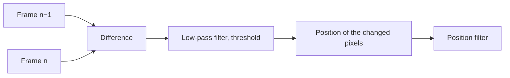

# Frame differencing

- **Status:** Candidate
- **Decision:** none yet
- **Open questions:** Q6, Q7
- **Lives in:** n/a

## What it is

A classical image-processing method with no trained model. It subtracts consecutive video frames (the derivative of the image over time) and treats the pixels that changed as motion. Per frame it produces the changed pixels, and from them a position for the moving lizard.

## How it works

1. Subtract the previous frame from the current one, pixel by pixel: x[n] − x[n−1].
2. Low-pass filter, so that single-sample noise is not counted as motion, and keep the pixels whose change is large enough. The board sketches the two-sample average (x[n] + x[n−1]) / 2 and marks a level H on the intensity trace.
3. Take the position from the pixels that remain. The board draws the result as one dot in the frame.
4. Pass the position to a filter that tracks it over time: a [Kalman filter](kalman-filter.md) or a [Bayes filter](bayes-filter.md).

## Pros

- No model to obtain, train, or run. The brief does not want a YOLO model unless it is necessary.
- Cheap: one subtraction per pixel per frame.

## Cons

- A zero difference is ambiguous: it occurs when the frame repeats (Q7), when the lizard is still, and when the lizard is not on screen. Differencing alone cannot tell these apart.
- Everything that changes counts as motion, not only the lizard: lighting, noise, anything else that moves in the enclosure.
- It gives where pixels changed, not where the whole lizard is.

These follow from how the method works. None has been measured on our video.

## Evidence

Notes and experiments, with what each showed.

- [`docs/notes/2026-11-14-project-brief.md`](../notes/2026-11-14-project-brief.md#motion-tracking) § Motion tracking: proposes the derivative between frames to detect motion (s. 33) and raises the repeated-frame problem (s. 35–36).
- [`docs/notes/2026-11-14-whiteboard-system-design.md`](../notes/2026-11-14-whiteboard-system-design.md#motion-tracking-centre) § Motion tracking, § Video processing: the difference x[n] − x[n−1], the subtraction of two frames, the low-pass filter, and the "frame stayed same" gap. Also a 3×3 grid with rows "1 0 −1", whose role is not stated.
- Experiments: none yet.
