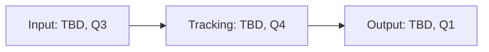

# Architecture

Current state only. An undecided part links its open question or approach page instead of describing a design. The three components below are a placeholder decomposition; replace them once Q1 is answered.

## Block diagram

## Components

One section per component: purpose, chosen approach (link the approach page and the decision), where it lives in `src/`, open questions.

### Input

**Design:** not decided. Camera, recorded video, sensor data? See [Q3](open-questions.md).

### Tracking

**Design:** not decided. Candidate approaches: none documented yet. See [approaches/](approaches/) and [Q4](open-questions.md).

### Output

**Design:** not decided. What RepTracker reports and to whom: [Q1](open-questions.md).
