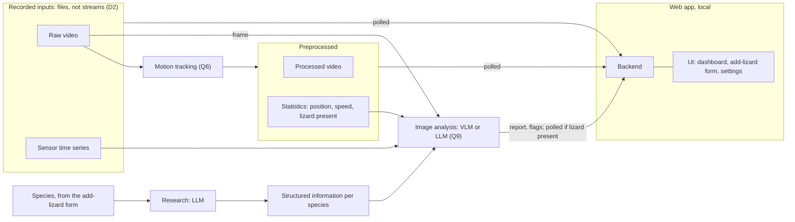

# Architecture

Current state only. An undecided part links its open question or approach page instead of describing a design. Nothing is implemented yet, so no component has a place in `src/`.

Sources: the 2026-11-14 notes, cited below as [brief](notes/2026-11-14-project-brief.md), [board](notes/2026-11-14-whiteboard-system-design.md), and [UI board](notes/2026-11-14-whiteboard-ui.md).

## Block diagram

## Components

One section per component: purpose, chosen approach (link the approach page and the decision), where it lives in `src/`, open questions.

### Recorded inputs

**Purpose:** stand in for cameras and sensors.

**Design:** decided ([D2](decisions.md)): video and sensor data are finite files, not streams. The video is one recording the team makes of a real lizard, plus recordings found online of other lizards in their enclosures; the sensors are finite time series ([brief § Inputs][b-inputs]). Cameras are named top and side, and are drawn as files listed in JSON ([board § Add lizard][s-add]).

**Open:** which videos, in what form ([Q14](open-questions.md)); which sensors, in what file format ([Q13](open-questions.md)); how a finite video maps onto dashboard time ([Q15](open-questions.md)).

### Motion tracking

**Purpose:** video in, position of the lizard out ([brief § Motion tracking][b-motion]). The board labels this stage DSP and draws it as raw video to processed video ([board § Motion tracking][s-motion], [§ Design decisions][s-dd]).

**Design:** not decided ([Q6](open-questions.md)). Candidates: [frame differencing](approaches/frame-differencing.md) to detect motion; a [Kalman filter](approaches/kalman-filter.md) or a [Bayes filter](approaches/bayes-filter.md) to track position; a [YOLO detector](approaches/yolo-detector.md) only if those are not enough.

**Open:** which pipeline ([Q6](open-questions.md)); repeated frames ([Q7](open-questions.md)).

### Statistics

**Purpose:** the numbers behind the stats panel and the movement graph, and context for the image analysis ([board § Design decisions][s-dd]).

**Design:** from the processed video: position, speed, lizard present ([brief § Statistics][b-stats]).

**Open:** the full list and its units ([Q11](open-questions.md)); what decides lizard present ([Q8](open-questions.md)).

### Research

**Purpose:** reference information about a species, for the image analysis.

**Design:** the species from the add-lizard form goes to an LLM through an API call, preferably with structured output. The result is structured information per species, which the board also calls a knowledge base and research files ([brief § Research and image analysis][b-ai]; [board § AI pipeline][s-ai]).

**Open:** its fields, whether it includes images, where it is stored, whether the UI displays it ([Q12](open-questions.md)); the model ([Q9](open-questions.md)).

### Image analysis

**Purpose:** a status for each lizard, and alerts.

**Design:** the backend polls the model at a poll rate, and only if the lizard is present. The model gets a frame of the raw video, sensor values, the statistics, and the research files. It returns a structured report with a status from a finite set, or says the lizard is not in frame; the result is shown in the UI as a human-readable analysis, and flags become alerts ([brief § Research and image analysis][b-ai]; [board § AI pipeline][s-ai], [§ Design decisions][s-dd]). Preferably one AI API call per poll.

**Open:** the model, and whether it must be a VLM ([Q9](open-questions.md)); the poll rate and what decides lizard present ([Q8](open-questions.md)); the statuses and the report's fields ([Q10](open-questions.md)).

### Web app

**Purpose:** what the user sees: add and monitor lizards ([UI board § Dashboard][u-dash]).

**Design:** three layers as drawn on the board: UI, web interface, backend. The backend calls a layer of functions, and the functions reach the LLM and the simulated video and sensors ([board § High level][s-high]). The board annotates the web interface "HTML, CSS" and the backend "Flask"; language and tooling are not decided ([Q2](open-questions.md)). Next to the functions layer the board says "Function names stay the same"; what that covers is not written down.

| Page | Contents | Source |
|---|---|---|
| Dashboard | A status and alerts bar at the top. Per lizard: name, stats, videos, movement graph, "AI questions". An Add button. | [UI board § Dashboard][u-dash]; [brief § Web app][b-web] |
| Add lizard | Lizard: name, age, species, optional previous data. Hardware: cameras (top, side), sensors. | [UI board § Add lizard form][u-form]; [board § Add lizard][s-add] |
| Settings | Keys. The AI API key is set at runtime and not stored. | [UI board § Settings][u-settings]; [board § Secrets and settings][s-secrets] |

**Open:** "previous data" and "AI questions" ([Q17](open-questions.md)); whether research results are displayed ([Q12](open-questions.md)).

[b-ai]: notes/2026-11-14-project-brief.md#research-and-image-analysis
[b-stats]: notes/2026-11-14-project-brief.md#statistics
[b-web]: notes/2026-11-14-project-brief.md#web-app
[b-inputs]: notes/2026-11-14-project-brief.md#inputs
[b-motion]: notes/2026-11-14-project-brief.md#motion-tracking
[s-secrets]: notes/2026-11-14-whiteboard-system-design.md#secrets-and-settings-top-left
[s-add]: notes/2026-11-14-whiteboard-system-design.md#add-lizard-middle-left
[s-high]: notes/2026-11-14-whiteboard-system-design.md#high-level-bottom-left
[s-motion]: notes/2026-11-14-whiteboard-system-design.md#motion-tracking-centre
[s-ai]: notes/2026-11-14-whiteboard-system-design.md#ai-pipeline-top-right
[s-dd]: notes/2026-11-14-whiteboard-system-design.md#design-decisions-bottom-right
[u-dash]: notes/2026-11-14-whiteboard-ui.md#dashboard
[u-settings]: notes/2026-11-14-whiteboard-ui.md#settings
[u-form]: notes/2026-11-14-whiteboard-ui.md#add-lizard-form
