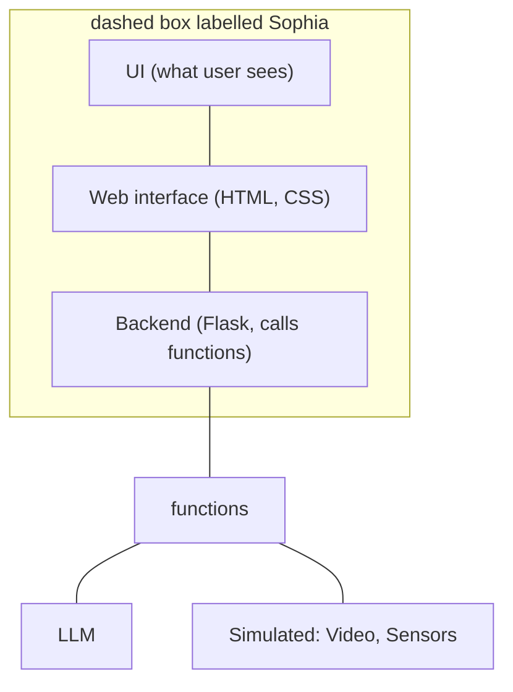
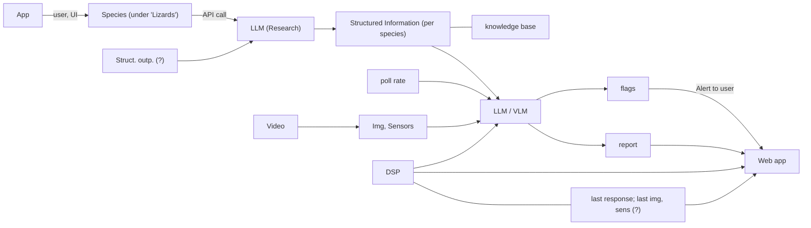
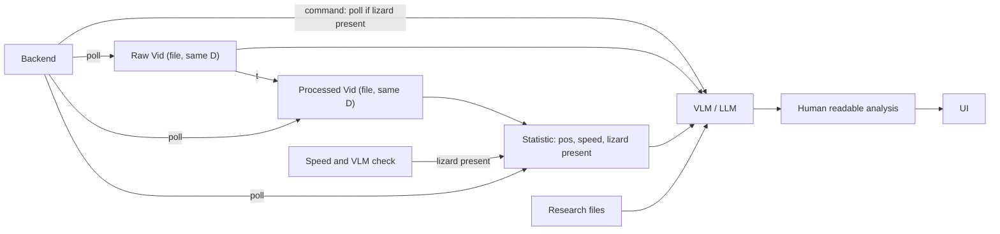

# Whiteboard: system design (photo, received 2026-11-14)

## Summary

A photo of a two-panel whiteboard that sketches the whole system. The left panel has secrets and settings, the add-lizard flow, the software stack, and the motion-tracking math. The right panel has the AI pipeline from species to alerts, and a "Design decisions" section with the data flow between raw video, processed video, statistics, and the VLM/LLM. It was attached to the [project brief](2026-11-14-project-brief.md), which says the board shows the same content (s. 40–41). The photo does not say when or by whom the board was drawn. Everything is handwritten; `[?]` marks an uncertain reading.

## Key points

Each heading names a region of the photo. Diagrams are redrawn from the board: same boxes, labels, and arrows.

### Secrets and settings (top left)

- "Secrets: API key and Website". "API key set at runtime". "User get api" [?].
- A box "Web": "All local", "Config".
- "Settings page": "API key", ticked, with "not stored" beside it; "Species".
- A dashboard sketch below: an "Add" button; a section "L1" holding "Spe." and a block of text, labelled "real"; a section "L2" holding "Spe." and "Alerts", labelled "fake". Arrows run from "Species" to the "Spe." field and from "API key" to an asterisk in the corner of the sketch.

### Add lizard (middle left)

- A box "Add Lizard": "Species"; "add cameras"; "select camera: top, side"; "add sensors: select".
- Beside it: "file" pointing at a list "Cam1, C2, C3", bracketed to "select camera", with an arrow into the list from "JSON".

### High level (bottom left)

- Next to "functions", joined by a dotted line: "Function names stay the same".

### Motion tracking (centre)

- Heading "Motion Track…" (cut off at the panel edge). On the right panel, "DSP" with an arrow pointing at this column.
- "Δx/Δn" and "x[n] − x[n−1]".
- Two frames joined by an arrow marked "t+1". "(d/dt) f = f′".
- A step in "val" between "white" and "black" [?]. A 3×3 grid with "1 0 −1" in every row. A 3×3 grid with hatched cells and an arrow at one cell boundary.

### Video processing (bottom centre)

- "Video processing": two frames, a minus sign, and a result frame with a few marks left in it.
- "df/dt" above a frame that contains a single dot.
- "Kalman filter" and "Bayes", next to an outline of a lizard.
- "I(p, t)", with "fix" pointing at p. Beside it a noisy trace on an "I" axis with a level "H" marked, "single" [?] pointing at one sample, "(x[n] + x[n−1]) / 2", and "LPF".
- A pulse with a gap in it; the gap is labelled "frame stayed same".

### AI pipeline (top right)

- "RepTracker" branches into "Website", "Video/Sensors", "Research".
- A box "Add" with two checkboxes: "Top camera", "Side camera".
- Under the heading "AI":

- "Profile:" is written beside "knowledge base", with nothing after it.

### Design decisions (bottom right)

- "Design decisions: Video and sensors are preprocessed so they don't require real time polling", and under it "files not streams".

- "Raw Vid" and "Processed Vid" are each marked "file" and "same D". The board does not say what D is.

## Relevance

The board is the team's first architecture sketch and adds what the brief leaves out:

- **Stack:** UI, web interface (HTML, CSS), backend (Flask), a functions layer, and simulated video and sensors underneath. A candidate answer to Q2.
- **Data flow:** raw video is processed into a processed video and statistics; the backend polls all three; the VLM/LLM gets raw video, statistics, and research files, and returns a human-readable analysis for the UI.
- **A recorded decision:** files, not streams, with its reason (Q3).
- **Secrets:** the API key is set at runtime and not stored.
- **Motion tracking (Q4):** frame differences, a low-pass filter on pixel intensity over time, a Kalman or Bayes filter, and the repeated-frame problem drawn as a gap in the signal.
- **Inputs:** cameras are named top and side and appear as files listed in JSON.

## Open questions

- Is Flask with HTML and CSS decided, or a sketch? (High level) → Q2
- What does "Function names stay the same" cover: which functions, and the same across what? (High level)
- What does the "Sophia" label on the dashed box mean? (High level)
- "Speed and VLM check" feeds "lizard present", and the backend polls the VLM/LLM "if lizard present": does presence need the VLM before the VLM is polled? (Design decisions) → Q10
- What is "D" in "same D"? (Design decisions)
- What do "real" and "fake" mean on sections L1 and L2? (Secrets and settings)
- What is the second secret in "API key and Website", and what does "User get api" [?] mean? (Secrets and settings)
- What do the "DSP" box and "last response; last img, sens" [?] pass to the LLM/VLM and the web app? (AI pipeline)
- What goes under "Profile:"? (AI pipeline)

## Actions

- [x] `docs/architecture.md`: the block diagram, the web app's layers, and the data flow of Statistics and Image analysis, from the High level, AI pipeline, and Design decisions diagrams
- [x] `docs/overview.md`: Alerts, Settings and secrets, and the AI access constraint
- [x] Logged D3 in `docs/decisions.md`: "files not streams" (Design decisions)
- [x] `docs/open-questions.md`: Flask with HTML and CSS is the candidate answer to Q2; cited in Q9, Q10, Q16
- [x] Cited the Motion tracking and Video processing regions under Evidence in `docs/approaches/frame-differencing.md`, `kalman-filter.md`, `bayes-filter.md`
